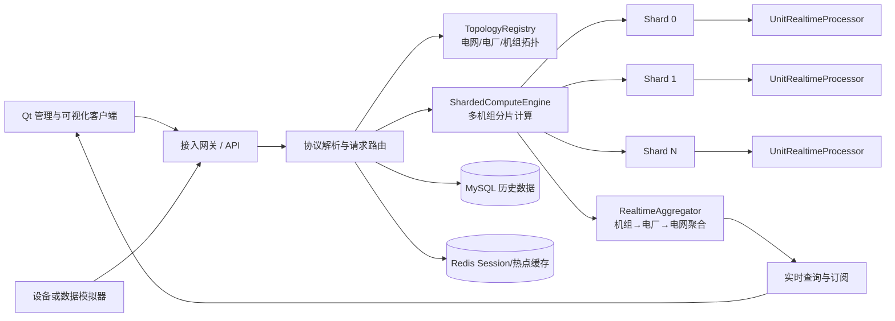
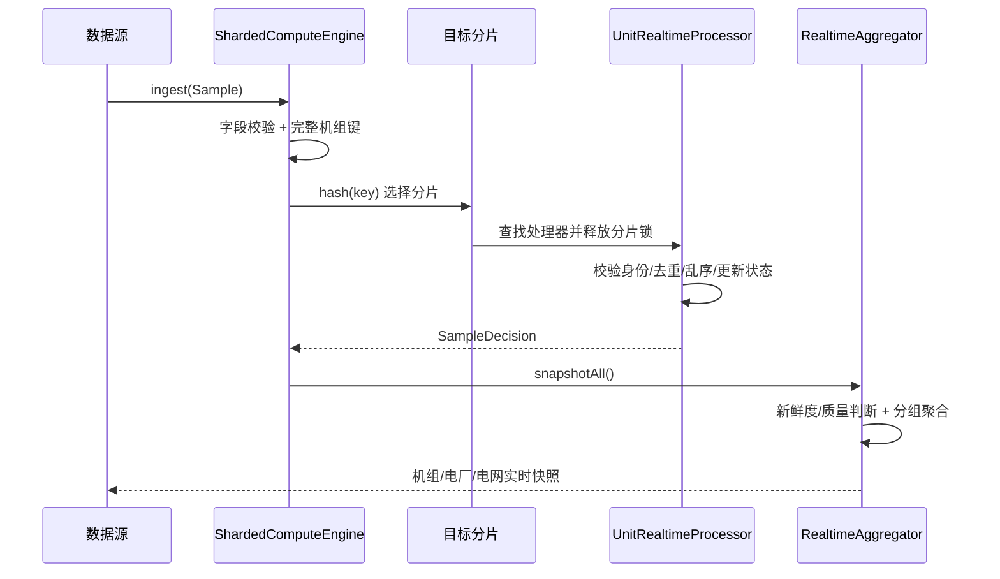
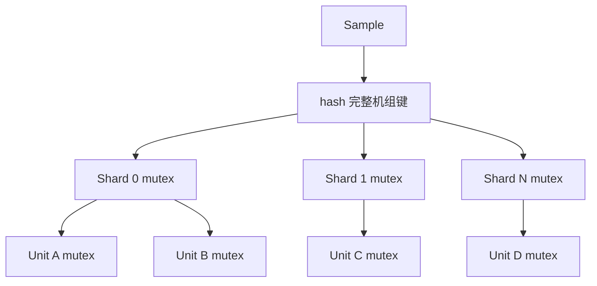

# PowerStation 开发档案

> 用途：记录项目架构、阶段目标、关键技术决策、测试证据、踩坑与演进路线，便于开发复盘、项目答辩和简历整理。

## 1. 项目定位

PowerStation 是一个面向电网终端场景的 C++17 工程。系统接收多个电网、多个电厂、多个机组的实时采样数据，完成数据校验、路由、状态维护、分级聚合、查询和可视化。

当前阶段优先构建可移植、可测试的领域与计算核心；网络通信、持久化、缓存和 Qt 客户端在核心模型稳定后逐层接入。

### 核心目标

- 管理“电网 → 电厂 → 机组”三级拓扑。
- 接收所有机组的实时 Sample，并路由到正确的处理器。
- 识别非法、未知机组、重复和乱序数据。
- 形成机组、电厂、电网三级实时快照。
- 支持后续历史数据、条件查询、图表展示和告警。
- 保持 Windows 开发阶段与 Linux/麒麟部署阶段的可迁移性。

### 当前非目标

- 暂不接入真实 PLC、DCS 或 Modbus 设备。
- 暂不实现 MySQL、Redis、Muduo 和 Qt 界面。
- 暂不追求分布式一致性；先保证单进程计算核心正确。

## 2. 总体架构



当前已经实现图中 `TopologyRegistry`、`UnitRealtimeProcessor` 和 `ShardedComputeEngine`；正在实现 `RealtimeAggregator`。其余组件属于后续阶段。

## 3. 当前代码分层

| 层次 | 当前模块 | 职责 |
|---|---|---|
| Domain | `Types` | Grid、Plant、Unit、Sample、数据质量、基础校验与标识 |
| Domain | `TopologyRegistry` | 线程安全地维护三级拓扑并提供查询/快照 |
| Compute | `UnitRealtimeProcessor` | 单机组数据校验、去重、乱序判断和最新状态维护 |
| Compute | `ShardedComputeEngine` | 多机组注册、分片路由和并发快照 |
| Compute | `RealtimeAggregator` | 将所有机组状态聚合为电厂级和电网级统计（进行中） |
| Application | 待设计 | 编排拓扑、计算、查询和持久化 |
| Infrastructure | 待设计 | Muduo、MySQL、Redis、日志和配置 |
| UI | 待设计 | Qt TableView、Charts/QCustomPlot 和交互 |

## 4. 实时数据流



## 5. 并发模型

### TopologyRegistry

- 拓扑属于低频写、普通频率读的数据。
- 当前使用 `std::mutex` 和 RAII 锁保护映射。
- 曾尝试 `std::shared_mutex`，但在当前 MinGW win32 线程模型下复现阻塞，因此现阶段选择稳定性更高的普通互斥锁。
- 性能优化优先通过缩短临界区、减少复制和拆分职责实现，不盲目替换读写锁。

### ShardedComputeEngine

- 使用完整机组标识进行哈希分片，避免所有机组竞争一把全局锁。
- 分片锁只保护“机组键 → 处理器”的映射。
- 从映射取得 `shared_ptr` 后立即释放分片锁，再进入单机组处理器。
- 每个 `UnitRealtimeProcessor` 拥有自己的互斥锁，不同机组能够并行计算。
- `snapshotAll()` 在分片锁内只复制处理器指针，调用处理器快照时不持有分片锁，避免嵌套持锁。
- 重复注册使用 `try_emplace`，保留已有实时状态；配置更新将来使用单独接口表达。



## 6. 关键技术决策

### CMake 与 Docker

CMake 和 Docker 不是替代关系：

- CMake 负责跨平台构建、目标依赖、编译选项和测试注册。
- Docker 负责提供一致的 Linux 运行环境和依赖部署。
- Windows 学习阶段先使用 CMake + MinGW；进入 Linux/麒麟集成阶段后再增加 Docker 镜像和部署脚本。

### 当前核心暂不引入第三方库

领域模型、并发计算和聚合逻辑优先使用 C++17 标准库实现，原因如下：

- 便于理解对象生命周期、锁粒度和线程安全边界。
- 降低 Windows 初期的依赖配置成本。
- 核心层不依赖 Muduo、Qt、数据库驱动，后续更容易在 Linux/麒麟复用。
- 单元测试可以在没有外部服务的情况下运行。

这不意味着所有组件都自行实现。协议、数据库客户端和 UI 等成熟领域应优先采用可靠库。

### 第三方库与自研边界

| 能力 | 候选方案 | 当前取舍 | 理由 |
|---|---|---|---|
| 构建 | CMake | 使用 | 跨平台且适合多目标工程 |
| 核心并发容器 | 标准库 + 自研封装 | 使用 | 学习锁粒度并保持核心独立 |
| JSON | nlohmann/json | 后续引入 | 不自行编写 JSON 解析器 |
| RPC 序列化 | Protobuf | RPC 阶段引入 | 二进制协议、兼容性和代码生成成熟 |
| 网络 | Muduo | Linux 阶段引入 | Reactor 和连接管理成熟；Windows 核心阶段不强行接入 |
| 数据库 | MySQL 官方客户端/合适的 C++ 封装 | 待验证 | 连接池由项目封装，底层协议不自行实现 |
| 缓存 | hiredis/redis-plus-plus | 待验证 | 不自行实现 Redis 协议和连接管理 |
| GUI | Qt | 后续引入 | 表格、信号槽和图表生态完整 |
| 日志 | 自研异步日志或 spdlog | 待基准后决定 | 自研有学习价值，生产可靠性需用测试证明 |
| 测试 | 当前轻量测试；未来考虑 GoogleTest | 分阶段 | 当前依赖少；测试规模扩大后使用成熟断言和 fixture |

## 7. 平台与工具链

- 当前平台：Windows x86_64。
- 编辑器：VSCode。
- 构建系统：CMake。
- 当前编译器：`x86_64-w64-mingw32` GCC，实际 Thread model 为 `win32`。
- 当前终端提示为 UCRT64，但终端名称不等于编译器线程模型，判断以 `g++ -v` 为准。
- 目标平台：Linux/麒麟 x86_64。
- 可移植策略：核心层不包含 Windows API；平台相关能力放入 Infrastructure 层。

## 8. 测试策略

- 每个领域/计算模块都有独立测试可执行文件。
- 所有测试通过 CTest 统一运行。
- 并发测试必须设置超时，防止死锁导致流水线永久阻塞。
- 功能分支提交前执行：

```bash
cmake --build build --parallel
ctest --test-dir build --output-on-failure --timeout 20
git diff --check
```

- 当前测试里程碑：
  - Domain：字段校验与完整机组键。
  - Topology：三级拓扑、非法引用和并发快照。
  - Unit realtime：合法、非法、重复、乱序和身份不匹配。
  - Sharded engine：未知机组、重复注册、跨电厂同名机组、多写者与多读者。
  - Realtime aggregation：状态分类、电厂/电网指标、空输入、非法配置和跨电网同名电厂隔离。

## 9. Git 工作流

唯一合并入口为 GitHub Pull Request：

```text
同步 main → 创建 feature 分支 → 本地开发/测试/提交
→ push feature → 创建 PR → GitHub Merge commit
→ 本地 main 执行 pull --ff-only
```

约束：

- 不直接在本地 `main` 开发。
- PR 创建后不再本地 `git merge feature/...`。
- GitHub 合并完成后，本地 `main` 只执行 `git pull --ff-only origin main`。
- 每次新功能从已同步的 `main` 创建新分支。
- 误操作先创建 backup 分支保留提交，再校准分支指针。

## 10. 阶段里程碑

| 阶段 | 分支/PR | 合并提交 | 结果 |
|---|---|---|---|
| 领域模型 | PR #1 | `73f94ea` | Grid、Plant、Unit、Sample 基础模型 |
| 拓扑注册表 | PR #2 | `c3fcf34` | 线程安全三级拓扑 |
| 单机组实时处理 | PR #3 | `2d5e30f` | 校验、去重、乱序和实时状态 |
| 多机组分片引擎 | PR #4 | `a7c0cb4` | 分片路由、并发快照和未知机组判断 |
| 实时分级聚合 | `feature/realtime-aggregation` | 进行中 | 机组状态汇总至电厂和电网 |

## 11. 已知问题与经验

### `shared_mutex` 阻塞

在当前 MinGW win32 线程模型下，拓扑并发测试使用 `std::shared_mutex` 时出现阻塞。现阶段改用 `std::mutex`，测试恢复稳定。后续在 Linux GCC/libstdc++ 环境重新基准验证后再决定是否引入读写锁。

### GitHub 与本地重复 Merge

PR #3 和 PR #4 阶段曾在 GitHub 合并后又在本地合并同一功能分支，导致本地和远端各自生成不同 Merge commit。通过备份本地提交并将 `main` 指针校准至 `origin/main` 恢复。由此确立“PR 是唯一合并入口”的规则。

### 完整机组键

当前 `makeUnitKey()` 使用 `/` 拼接电网、电厂和机组 ID。若未来 ID 允许任意外部输入，存在分隔符冲突的理论风险。进入外部接口阶段前应选择以下方案之一：

- 限制 ID 字符集合，不允许 `/`；
- 使用结构化复合键和自定义哈希；
- 使用长度前缀编码。

## 12. 当前阶段：实时分级聚合

### 设计目标

`RealtimeAggregator` 是无共享可变状态的计算组件。它接收 `ShardedComputeEngine::snapshotAll()` 的结果和明确的计算时间，不自行获取系统时间，从而保证测试可重复。

计划输出：

- 机组状态：Disabled、NoData、Fresh、Stale、BadQuality。
- 电厂聚合：机组数量、状态计数、装机容量、在线容量、有效有功、AGC 指令、平均频率和负载率。
- 电网聚合：电厂数量及相同维度的汇总指标。
- 全局快照：生成时间、电厂列表和电网列表。

### 数据纳入规则（初版）

- Disabled：机组未启用，不计入有效运行指标。
- NoData：没有最新 Sample。
- BadQuality：质量为 Bad 或 Missing。
- Stale：接收时间早于 `generatedAt - staleAfter`。
- Fresh：启用、存在 Sample、质量可用且未过期。
- 只有 Fresh 数据进入有功、AGC 和平均频率计算。
- 额定容量同时保留总启用容量和在线容量，避免负载率分母含义不清。

### 实现与验证记录（2026-10-29）

- 已实现无共享可变状态的 `RealtimeAggregator`，聚合过程本身不需要加锁。
- 聚合输入使用调用方传入的 `generatedAt`，没有在组件内部读取系统时间，测试结果可重复。
- 使用 `(gridId, plantId)` 作为电厂分组键，允许不同电网存在同名电厂。
- `DataQuality::Suspect` 当前仍纳入 Fresh 指标，同时通过 `suspectUnits` 单独计数。
- Bad、Missing、Stale、NoData 和 Disabled 状态不进入实时功率、AGC、频率及在线容量计算。
- 单模块测试共 18 项断言通过。
- CTest 共 5 个测试目标全部通过，总耗时约 0.06 秒。
- `git diff --check` 无空白错误。

## 13. 后续路线

1. 完成实时分级聚合。
2. 增加应用服务，统一编排拓扑和计算引擎。
3. 定义 JSON 请求/响应 DTO 和错误码。
4. 增加数据模拟器与批量导入。
5. 接入 MySQL 持久化和连接池。
6. 接入 Redis Session、节点路由和热点缓存。
7. 接入网络网关；Linux 阶段采用 Muduo。
8. 开发 Qt 管理与可视化客户端。
9. 增加异步日志、审计、性能测试和故障注入。
10. 增加 Linux/麒麟构建、Docker 环境与 CI。

## 14. 待验证事项

- 聚合数据对 Suspect 质量应纳入还是排除，需要结合业务口径确认。
- 过期阈值应采用全局配置还是按机组采样周期计算。
- `snapshotAll()` 是否需要提供严格同一时刻的一致性语义。
- 机组配置更新时如何保留实时状态并更新额定容量。
- Linux/麒麟上的锁、线程、时钟和性能表现。
- 历史数据的时段粒度、补数规则和幂等键设计。
